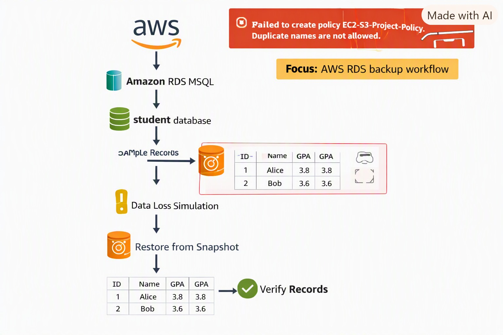
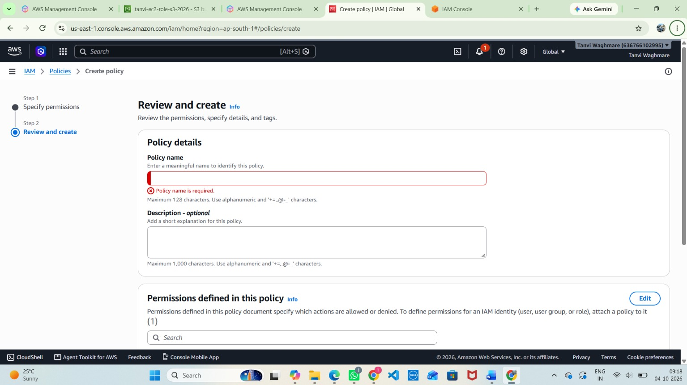
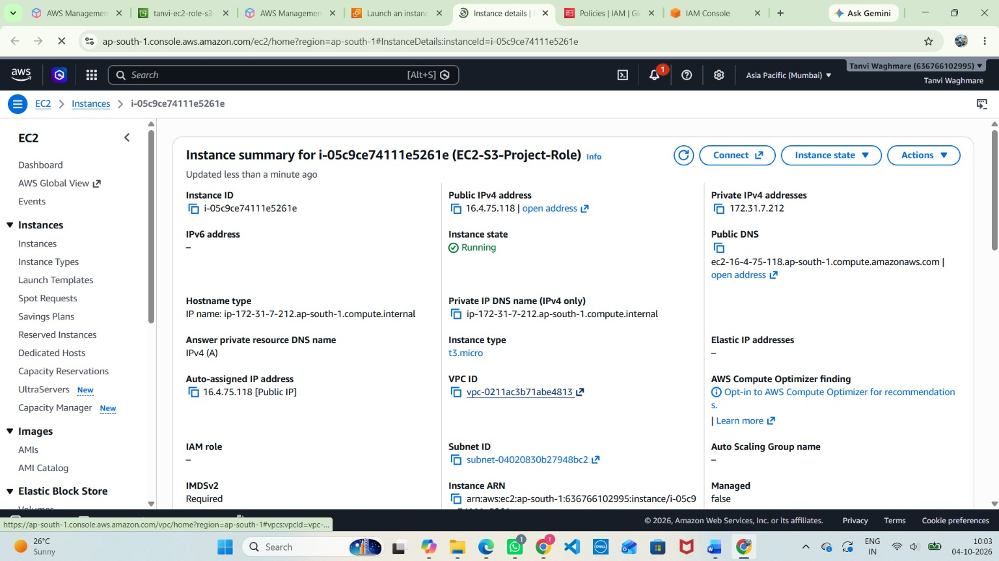
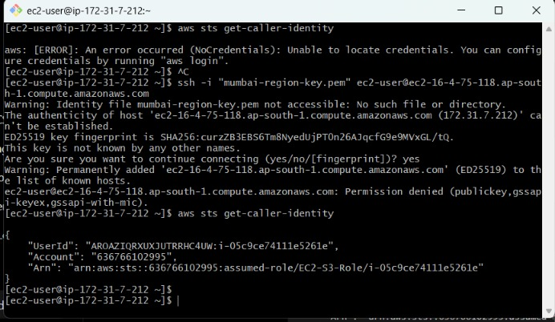
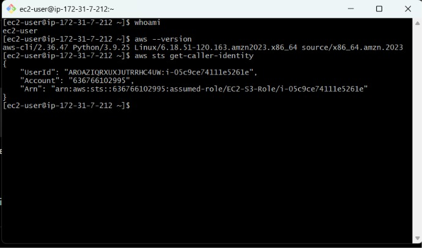
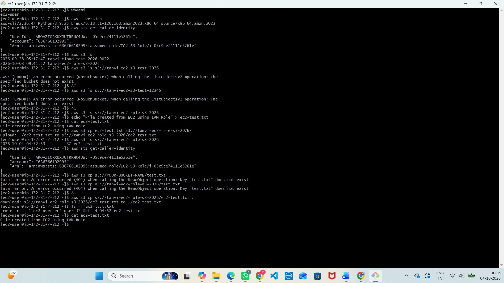

# AWS Project: EC2 IAM Role for S3 Access

## 📌 Project Overview

This project demonstrates how to configure an **IAM Role** for an Amazon EC2 instance so it can securely access an **Amazon S3 bucket** without storing AWS access keys on the server.

By attaching the IAM role directly to the EC2 instance, AWS automatically provides **temporary credentials**, which follows cloud security best practices.

---

## 🏗️ Architecture

| Component | Purpose |
|-----------|---------|
| **IAM Role** | Trusted entity is EC2, with permissions to access S3 |
| **EC2 Instance** | Launched with the IAM role attached |
| **Amazon S3 Bucket** | Target bucket for storing and retrieving files |
| **AWS CLI** | Used inside EC2 to verify access and perform S3 operations |

```
EC2 Instance  --(assumes)-->  IAM Role  --(permissions)-->  Amazon S3 Bucket
```



*Figure: EC2 instance accessing an S3 bucket through an attached IAM role.*

---

## ⚙️ Implementation Steps

### 1. Create the IAM Role

1. Navigate to **IAM → Roles → Create role**.
2. Select **AWS service** and choose **EC2** as the trusted entity.
3. Attach the policy `AmazonS3FullAccess` (or a custom policy limited to specific buckets).
4. Name the role, for example `EC2-S3-Role`, and create it.

📸 **Screenshot: IAM Role Creation**


📸 **Screenshot: Role Created with S3 Policy Attached**



---

### 2. Launch an EC2 Instance with the IAM Role

1. Launch a new EC2 instance (for example, `t3.micro`).
2. Under **Advanced details → IAM instance profile**, select `EC2-S3-Role`.
3. Verify instance details such as public IP, DNS, and VPC configuration.

📸 **Screenshot: Attaching the IAM Role While Launching**



📸 **Screenshot: EC2 Instance Summary**



---

### 3. Verify the IAM Role from EC2

1. Connect to the EC2 instance via SSH.
2. Run the following command to check the identity:

```bash
aws sts get-caller-identity
```

The output should show the **assumed role ARN** linked to the EC2 instance.

📸 **Screenshot: Caller Identity Output**



---

### 4. Test S3 Access

Run the AWS CLI commands below to interact with the S3 bucket:

```bash
# List buckets
aws s3 ls

# Create a test file
echo "Hello from EC2" > ec2-test.txt

# Upload the file to S3
aws s3 cp ec2-test.txt s3://your-bucket-name/

# Download the file from S3
aws s3 cp s3://your-bucket-name/ec2-test.txt .
```

Verify that the upload and download succeed **without configuring any access keys**.

📸 **Screenshot: S3 Operations**



---

### 5. Backup & Recovery Demonstration (Optional Extension)

1. Create a sample file in S3.
2. Simulate data loss by deleting the file.
3. Restore from backup or re-upload using the EC2 IAM role.
4. Verify the restored records.

```bash
# Delete the file (simulate data loss)
aws s3 rm s3://your-bucket-name/ec2-test.txt

# Restore by re-uploading
aws s3 cp ec2-test.txt s3://your-bucket-name/

# Verify
aws s3 ls s3://your-bucket-name/
```

📸 **Screenshot: Backup & Recovery**


---

## 🔒 Recommended Least-Privilege Policy (Optional)

Instead of `AmazonS3FullAccess`, restrict the role to a single bucket:

```json
{
  "Version": "2012-10-17",
  "Statement": [
    {
      "Effect": "Allow",
      "Action": ["s3:ListBucket"],
      "Resource": "arn:aws:s3:::your-bucket-name"
    },
    {
      "Effect": "Allow",
      "Action": ["s3:GetObject", "s3:PutObject", "s3:DeleteObject"],
      "Resource": "arn:aws:s3:::your-bucket-name/*"
    }
  ]
}
```

---

## 🧪 Verification Results

- ✅ IAM role created successfully and attached to EC2.
- ✅ EC2 identity verified using `aws sts get-caller-identity`.
- ✅ S3 operations performed successfully (list, upload, download).
- ✅ No AWS access keys stored on the server. Credentials are provided securely via the IAM role.

---

## 📖 Key Learnings

- IAM roles eliminate the need to hardcode or store AWS credentials.
- EC2 instances can securely access S3 using temporary credentials.
- Always verify permissions using AWS CLI commands.
- Best practice is to restrict policies to specific buckets instead of granting full access.

---

## 🧹 Cleanup

1. Terminate the EC2 instance.
2. Empty and delete the test S3 bucket.
3. Delete the IAM role `EC2-S3-Role`.